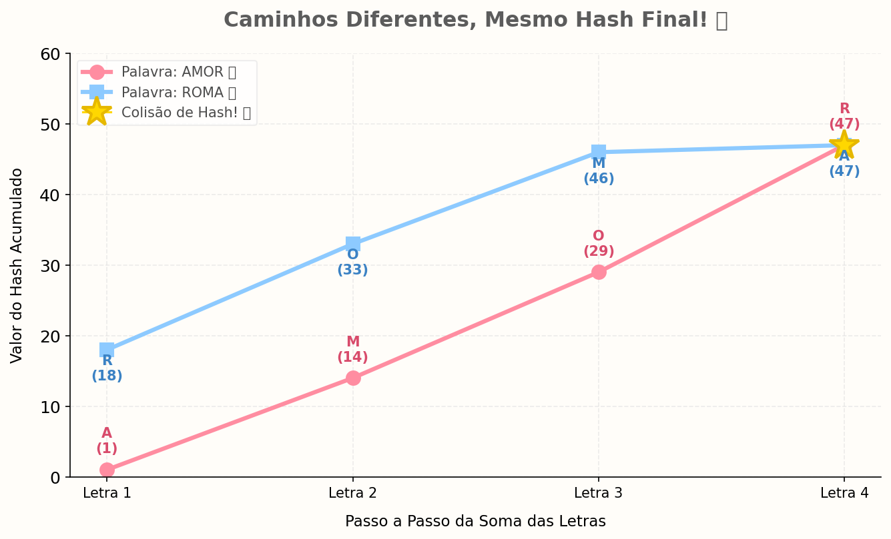

# 🌸 Desafio de Hash: Encontrando Colisões! ✨

Neste projeto, explorei o conceito de **funções de hash** e como palavras diferentes podem gerar o mesmo resultado numérico (o que chamamos de **colisão de hash**).

## 🐳 O Desafio
O objetivo do desafio de aula era encontrar duas palavras diferentes com pelo menos duas letras que gerassem o mesmo valor usando a função `calcula_hash`.

### 💖 Solução Escolhida
Utilizei as palavras **AMOR** e **ROMA**! Como a função base soma o valor das letras, mudar a ordem delas não altera o resultado final da soma:
* `A + M + O + R` = **47**
* `R + O + M + A` = **47** 🌟

## 📊 Visualização Gráfica
Abaixo está o gráfico gerado pelo script em Python que mostra o acúmulo dos valores passo a passo e o ponto final de colisão:

---
🛠️ **Tecnologias:** Python, Matplotlib e NumPy.
